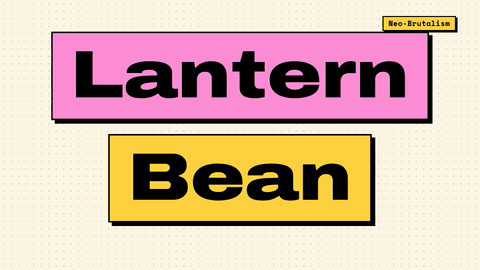
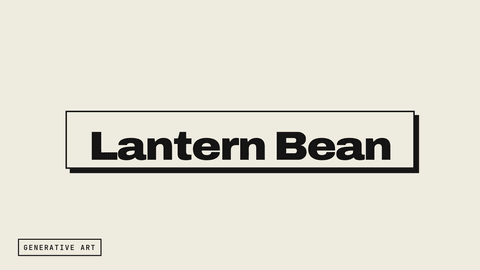

# skills

My collection of skills for Claude Code. Each skill is one folder in `skills/`.

## Skills

| Skill | What it does |
|---|---|
| [resilience-check](skills/resilience-check) | Checks if your app survives failures (timeouts, retries, double charges, dead cache, crashes) and writes a plain-language report with fixes. |

### Motion design styles

| Skill | What it does |
|---|---|
| [papercraft](skills/papercraft) | Paper pop-up style for videos, games and web pages. |

More skills will be added here.

## Design styles

[26 motion design styles and 3 layouts](design-styles/), each with a GIF demo, build notes, a prompt and demo source. These are reference folders, not skills.

<a href="design-styles/"></a> <a href="design-styles/"></a> <a href="design-styles/"></a>

## Install one skill

```
npx skills add KaushikDas9/skills@<skill-name>
```

Example:

```
# for this project only
npx skills add KaushikDas9/skills@resilience-check

# for all your projects
npx skills add KaushikDas9/skills@resilience-check -g
```

Or copy one skill folder into one of these places:

- `~/.claude/skills/<skill-name>/` for all your projects
- `<your-project>/.claude/skills/<skill-name>/` for one project

## Layout

```
skills/
└── <skill-name>/
    ├── SKILL.md          the steps Claude follows
    ├── README.md         details for people
    ├── references/       extra files Claude reads when needed
    └── evals/            test cases
```

## License

MIT. A skill folder with its own `LICENSE` file is covered by that file. Fonts in `design-styles/` keep their own licences, saved beside them.
