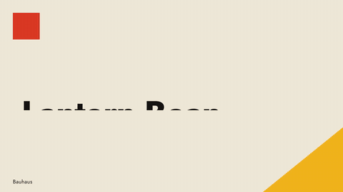

# Bauhaus



**Good for:** Brand intros, design and teaching videos

## The root idea

Everything is built from circles, squares, triangles and straight bars. Each shape has one flat basic colour.

## How to build it

1. Use a warm off-white ground so the basic colours feel printed.
2. Place a few large shapes first, then align the text to a bar or an edge.
3. Draw objects (like the cup) from the same simple shapes.
4. Use one geometric typeface.

## How it moves

Shapes slide in on straight paths and stop firmly. Bars wipe between scenes.

## Avoid

- Gradients and soft shadows
- Many small decorations
- More than a few colours

## Colours in this demo

`#F0E9DA` `#161514` `#1F4FA3` `#DB3A26` `#F2B419` `#6E675E`

## How this demo is made

A single HTML page animated with GSAP and rendered with HyperFrames.

- Clipping cuts or reveals shapes.

## Prompt to reuse

```text
Make a [LENGTH]-second HyperFrames video about [TOPIC].
Style: geometric flat shapes (circle, square, triangle, bars), basic red, blue and yellow with black on warm off-white, geometric sans-serif.
Movement: Shapes slide in on straight paths and stop firmly. Bars wipe between scenes.
Make your own design. Keep the main text large and readable, and show only a little text at a time.
Before the final render, look at still frames and fix anything cut off, broken or hard to read.
```

## Render the demo again

```bash
cd source
npx hyperframes@latest render --output demo.mp4
```

Needs Node.js, FFmpeg and an internet connection (GSAP loads from a CDN). Fonts are in `source/assets/` with their licence files.

The shop "Lantern Bean" is made up.
