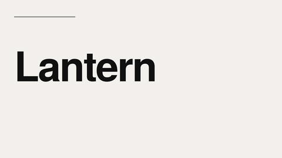

# Swiss Style



**Good for:** Corporate, education and information videos

## The root idea

Order comes from an invisible grid. Type size and empty space do the design work.

## How to build it

1. Set a column grid and keep every item on it.
2. Align text to the left.
3. Make the main words very large and the rest small.
4. Use black, off-white and one strong accent colour.

## How it moves

Calm, short moves along the grid. A rule line draws in. Nothing bounces.

## Avoid

- Centred layouts
- Decoration without a job
- A second accent colour

## Colours in this demo

`#111111` `#7A7A78` `#E30613` `#F5F4F0`

## How this demo is made

A single HTML page animated with GSAP and rendered with HyperFrames.

- Shapes and objects are drawn with SVG.
- Lines are revealed by animating the stroke dash.

## Prompt to reuse

```text
Make a [LENGTH]-second HyperFrames video about [TOPIC].
Style: strict grid, flush-left bold neo-grotesque type, off-white, black and one red accent, large empty space.
Movement: Calm, short moves along the grid. A rule line draws in. Nothing bounces.
Make your own design. Keep the main text large and readable, and show only a little text at a time.
Before the final render, look at still frames and fix anything cut off, broken or hard to read.
```

## Render the demo again

```bash
cd source
npx hyperframes@latest render --output demo.mp4
```

Needs Node.js, FFmpeg and an internet connection (GSAP loads from a CDN). Fonts are in `source/assets/` with their licence files.

The shop "Lantern Bean" is made up.
