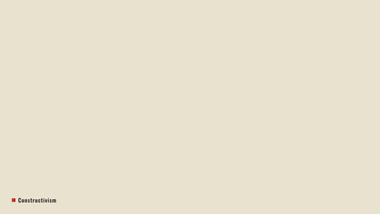

# Constructivism



**Good for:** Bold announcements and openings

## The root idea

Energy comes from one strong diagonal and hard shapes pushing against each other.

## How to build it

1. Choose one tilt angle and repeat it.
2. Use large discs, wedges and bars in red and black on paper colour.
3. Set condensed bold type and keep reading text level.
4. Build objects with hard corners.

## How it moves

Fast moves along the diagonal with sharp stops. Wedges wipe the screen.

## Avoid

- Political symbols or slogans (not needed for the look)
- Soft curves everywhere
- Many angles at once

## Colours in this demo

`#161412` `#D3261C` `#ECE4D2` `#8F897D` `#F6F1E6`

## How this demo is made

A single HTML page animated with GSAP and rendered with HyperFrames.

- Shapes and objects are drawn with SVG.

## Prompt to reuse

```text
Make a [LENGTH]-second HyperFrames video about [TOPIC].
Style: strong diagonal composition, red and black wedges and discs on aged paper, condensed bold type.
Movement: Fast moves along the diagonal with sharp stops. Wedges wipe the screen.
Make your own design. Keep the main text large and readable, and show only a little text at a time.
Before the final render, look at still frames and fix anything cut off, broken or hard to read.
```

## Render the demo again

```bash
cd source
npx hyperframes@latest render --output demo.mp4
```

Needs Node.js, FFmpeg and an internet connection (GSAP loads from a CDN). Fonts are in `source/assets/` with their licence files.

The shop "Lantern Bean" is made up.
