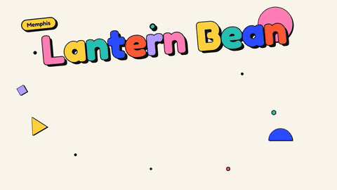

# Memphis



**Good for:** Social posts, youth brands, fun promos

## The root idea

Playful clashing shapes with the same black outline and hard shadow, scattered with a rhythm.

## How to build it

1. Use candy colours on a pale ground.
2. Give every object a black outline and an offset shadow with no blur.
3. Scatter squiggles, triangles, half circles and dots around the edges.
4. Keep the centre clear for the message.

## How it moves

Pieces pop with overshoot and a little squash.

## Avoid

- Shapes covering text
- Blurred shadows
- Equal spacing that looks like a grid

## Colours in this demo

`#111111` `#FFD23F` `#22C3B5` `#FF7EB6` `#2D4BFF` `#FF5A36`

## How this demo is made

A single HTML page animated with GSAP and rendered with HyperFrames.

- Shapes and objects are drawn with SVG.
- Clipping cuts or reveals shapes.
- Lines are revealed by animating the stroke dash.

## Prompt to reuse

```text
Make a [LENGTH]-second HyperFrames video about [TOPIC].
Style: 1980s playful shapes, candy colours, black outlines with hard offset shadows, squiggles and confetti, rounded bold type.
Movement: Pieces pop with overshoot and a little squash.
Make your own design. Keep the main text large and readable, and show only a little text at a time.
Before the final render, look at still frames and fix anything cut off, broken or hard to read.
```

## Render the demo again

```bash
cd source
npx hyperframes@latest render --output demo.mp4
```

Needs Node.js, FFmpeg and an internet connection (GSAP loads from a CDN). Fonts are in `source/assets/` with their licence files.

The shop "Lantern Bean" is made up.
