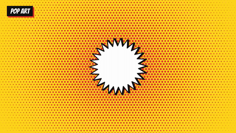

# Pop Art



**Good for:** Ads, offers, reels

## The root idea

It looks printed: tone is made with dots, and every colour area has a thick black line.

## How to build it

1. Fill grounds with flat primary colours.
2. Make tone with a dot pattern whose dot size changes.
3. Outline objects thickly and add a hard offset shadow.
4. Put loud words in a burst and calm text in a box.

## How it moves

Elements slap onto the screen: start large, land fast.

## Avoid

- Soft gradients
- Thin lines
- Text sitting directly on busy dots

## Colours in this demo

`#FFD31A` `#E62E2D` `#FFFFFF` `#1E5BC6` `#111111` `#FFF4DC`

## How this demo is made

A single HTML page animated with GSAP and rendered with HyperFrames.

- Shapes and objects are drawn with SVG.
- Clipping cuts or reveals shapes.

## Prompt to reuse

```text
Make a [LENGTH]-second HyperFrames video about [TOPIC].
Style: comic print look, halftone dots, thick black outlines, flat yellow, red and blue, comic lettering in bursts and caption boxes.
Movement: Elements slap onto the screen: start large, land fast.
Make your own design. Keep the main text large and readable, and show only a little text at a time.
Before the final render, look at still frames and fix anything cut off, broken or hard to read.
```

## Render the demo again

```bash
cd source
npx hyperframes@latest render --output demo.mp4
```

Needs Node.js, FFmpeg and an internet connection (GSAP loads from a CDN). Fonts are in `source/assets/` with their licence files.

The shop "Lantern Bean" is made up.
