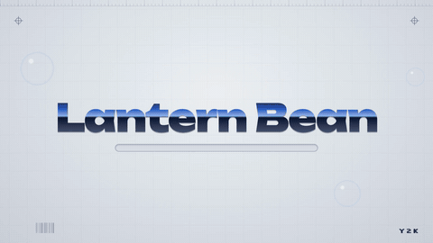

# Y2K



**Good for:** Tech and nostalgia content

## The root idea

The shiny optimistic computer look of around 2000: glossy surfaces, window panels and metal type.

## How to build it

1. Start with a pale silver ground with a fine grid.
2. Build a window panel with a title bar.
3. Make glossy objects with layered gradients and a sharp highlight.
4. Give metal type enough dark contrast to stay readable.

## How it moves

Panels open and shine moves across surfaces.

## Avoid

- Pale text on pale silver
- Heavy blur behind letters
- Copying a real operating system

## Colours in this demo

`#FFFFFF` `#0A1633` `#EEF0F4` `#5E6880` `#C9CED8` `#D9DEE6`

## How this demo is made

A single HTML page animated with GSAP and rendered with HyperFrames.

- Shapes and objects are drawn with SVG.
- Lines are revealed by animating the stroke dash.
- Gradients are used for colour or light.

## Prompt to reuse

```text
Make a [LENGTH]-second HyperFrames video about [TOPIC].
Style: year-2000 futurism, glossy gel surfaces, silver and aqua, window panels, wide techno type.
Movement: Panels open and shine moves across surfaces.
Make your own design. Keep the main text large and readable, and show only a little text at a time.
Before the final render, look at still frames and fix anything cut off, broken or hard to read.
```

## Render the demo again

```bash
cd source
npx hyperframes@latest render --output demo.mp4
```

Needs Node.js, FFmpeg and an internet connection (GSAP loads from a CDN). Fonts are in `source/assets/` with their licence files.

The shop "Lantern Bean" is made up.
