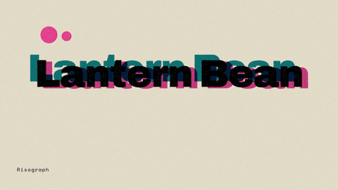

# Risograph



**Good for:** Posters, culture and event videos

## The root idea

A few spot inks printed one at a time, slightly out of line, on grainy paper.

## How to build it

1. Limit yourself to a few inks.
2. Overlap layers with multiply blending so a new colour appears.
3. Shift one layer a few pixels for misprint.
4. Add paper grain and rough edges with a noise filter.

## How it moves

Layers slide in separately and settle almost, not fully, in line.

## Avoid

- Perfect clean vectors
- Too many inks
- Misprint so large that text blurs

## Colours in this demo

`#00838A` `#FF48B0` `#FFB511` `#000000` `#D93D96` `#F3ECDB`

## How this demo is made

A single HTML page animated with GSAP and rendered with HyperFrames.

- Shapes and objects are drawn with SVG.
- An SVG noise filter adds texture.
- A displacement filter bends edges so they are less perfect.
- Blend modes mix overlapping colours.
- Lines are revealed by animating the stroke dash.
- Gradients are used for colour or light.
- Random placement uses a fixed seed, so each render is the same.

## Prompt to reuse

```text
Make a [LENGTH]-second HyperFrames video about [TOPIC].
Style: risograph print, limited spot inks with multiply overlap, slight misregistration, paper grain.
Movement: Layers slide in separately and settle almost, not fully, in line.
Make your own design. Keep the main text large and readable, and show only a little text at a time.
Before the final render, look at still frames and fix anything cut off, broken or hard to read.
```

## Render the demo again

```bash
cd source
npx hyperframes@latest render --output demo.mp4
```

Needs Node.js, FFmpeg and an internet connection (GSAP loads from a CDN). Fonts are in `source/assets/` with their licence files.

The shop "Lantern Bean" is made up.
