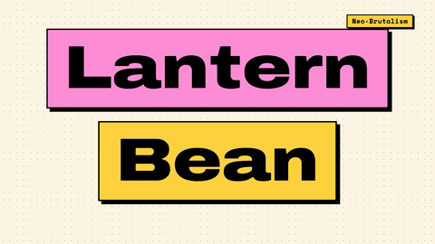

# Neo-Brutalism



**Good for:** Product videos, app promos, explainers

## The root idea

Honest blunt boxes: thick black borders, flat bright fills and solid shadows.

## How to build it

1. Put each piece of content in its own box.
2. Use one border width and one shadow offset everywhere.
3. Fill with flat bright colours on cream.
4. Use very heavy sans-serif type.

## How it moves

Boxes slam in and press down onto their shadows.

## Avoid

- Blur, glass or gradients
- Different border widths
- Crowding the boxes

## Colours in this demo

`#FFD23F` `#FFF6E5` `#B8F15A` `#000000` `#FFFFFF` `#FF8FD6`

## How this demo is made

A single HTML page animated with GSAP and rendered with HyperFrames.

- Shapes and objects are drawn with SVG.
- Lines are revealed by animating the stroke dash.
- Gradients are used for colour or light.

## Prompt to reuse

```text
Make a [LENGTH]-second HyperFrames video about [TOPIC].
Style: neo-brutalist boxes, thick black borders, hard black shadows, flat bright colours on cream, very bold sans-serif.
Movement: Boxes slam in and press down onto their shadows.
Make your own design. Keep the main text large and readable, and show only a little text at a time.
Before the final render, look at still frames and fix anything cut off, broken or hard to read.
```

## Render the demo again

```bash
cd source
npx hyperframes@latest render --output demo.mp4
```

Needs Node.js, FFmpeg and an internet connection (GSAP loads from a CDN). Fonts are in `source/assets/` with their licence files.

The shop "Lantern Bean" is made up.
