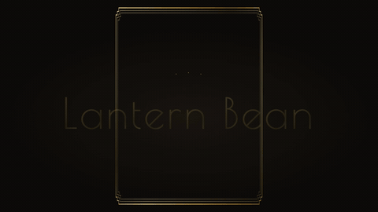

# Art Deco



**Good for:** Premium, hotel, event and luxury content

## The root idea

Symmetry on a centre line, with gold line work and repeated steps and rays.

## How to build it

1. Use a dark ground with gold, ivory and one jewel colour.
2. Mirror everything around the middle.
3. Frame the screen with nested stepped lines.
4. Add a faint sunburst behind the main item.
5. Use thin elegant capitals but keep them thick enough to read.

## How it moves

Lines draw outward from the centre. Slow and measured.

## Avoid

- Lines or letters too thin to see on a phone
- Asymmetry
- Bright candy colours

## Colours in this demo

`#C9A45A` `#F2DC9C` `#7E5E26` `#0E0D0B` `#1A1711` `#0E4A3C`

## How this demo is made

A single HTML page animated with GSAP and rendered with HyperFrames.

- Shapes and objects are drawn with SVG.
- Lines are revealed by animating the stroke dash.
- Gradients are used for colour or light.

## Prompt to reuse

```text
Make a [LENGTH]-second HyperFrames video about [TOPIC].
Style: 1920s symmetry, gold line work and sunburst on near-black, one emerald accent, stepped frames, elegant geometric capitals.
Movement: Lines draw outward from the centre. Slow and measured.
Make your own design. Keep the main text large and readable, and show only a little text at a time.
Before the final render, look at still frames and fix anything cut off, broken or hard to read.
```

## Render the demo again

```bash
cd source
npx hyperframes@latest render --output demo.mp4
```

Needs Node.js, FFmpeg and an internet connection (GSAP loads from a CDN). Fonts are in `source/assets/` with their licence files.

The shop "Lantern Bean" is made up.
