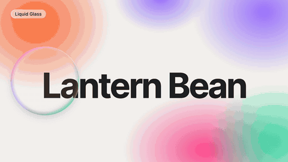

# Liquid Glass



**Good for:** App and interface promos

## The root idea

Clear panels are seen only by what they do to what is behind them: blur, bright rim and a soft highlight.

## How to build it

1. Put soft colour pools behind, or there is nothing to see through.
2. Make panels with background blur, a thin light rim and a soft shadow.
3. Move a highlight across the surface.
4. Keep reading text on a calm area.

## How it moves

Panels float and slide gently; highlights sweep.

## Avoid

- A lens that cuts through words
- Solid white boxes called glass
- Copying a real company interface

## Colours in this demo

`#FFFFFF` `#2A160B` `#F3F2EE` `#0B0C10` `#FF5A1F` `#FF2E7E`

## How this demo is made

A single HTML page animated with GSAP and rendered with HyperFrames.

- Shapes and objects are drawn with SVG.
- Backdrop blur softens what is behind a panel.
- Gradients are used for colour or light.

## Prompt to reuse

```text
Make a [LENGTH]-second HyperFrames video about [TOPIC].
Style: translucent glass panels with background blur and bright rims over soft colour pools, clean sans-serif.
Movement: Panels float and slide gently; highlights sweep.
Make your own design. Keep the main text large and readable, and show only a little text at a time.
Before the final render, look at still frames and fix anything cut off, broken or hard to read.
```

## Render the demo again

```bash
cd source
npx hyperframes@latest render --output demo.mp4
```

Needs Node.js, FFmpeg and an internet connection (GSAP loads from a CDN). Fonts are in `source/assets/` with their licence files.

The shop "Lantern Bean" is made up.
