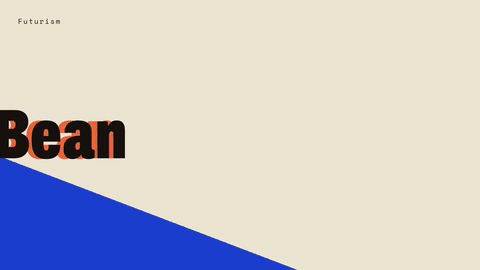

# Futurism



**Good for:** Sports, speed, launch videos

## The root idea

The subject is speed itself: slant, repeated after-images and wedges that point forward.

## How to build it

1. Set one direction of travel.
2. Make trails from fading copies offset along that direction.
3. Let letter width change with speed if the font allows it.
4. Remove the trails once the item stops, so it can be read.

## How it moves

Fast entrance, hard brake, short clean hold.

## Avoid

- Trails that stay over text
- Movement in all directions
- War or political imagery

## Colours in this demo

`#16130F` `#F2501C` `#B9BDC3` `#EDE5D3` `#1F3FD0` `#EA4D1B`

## How this demo is made

A single HTML page animated with GSAP and rendered with HyperFrames.

- Shapes and objects are drawn with SVG.
- Clipping cuts or reveals shapes.

## Prompt to reuse

```text
Make a [LENGTH]-second HyperFrames video about [TOPIC].
Style: speed and motion design, forward wedges and fading after-images, heavy type, orange, black and cobalt on paper.
Movement: Fast entrance, hard brake, short clean hold.
Make your own design. Keep the main text large and readable, and show only a little text at a time.
Before the final render, look at still frames and fix anything cut off, broken or hard to read.
```

## Render the demo again

```bash
cd source
npx hyperframes@latest render --output demo.mp4
```

Needs Node.js, FFmpeg and an internet connection (GSAP loads from a CDN). Fonts are in `source/assets/` with their licence files.

The shop "Lantern Bean" is made up.
