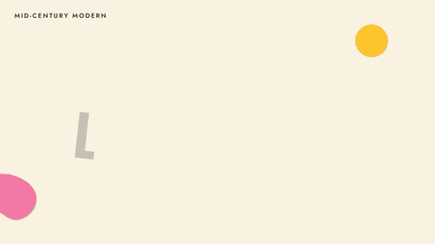

# Mid-Century Modern



**Good for:** Home, food and lifestyle content

## The root idea

Friendly cut-paper shapes from the 1950s: soft organic forms, small star and atom details, warm colours.

## How to build it

1. Use warm paper with tomato, mustard, teal and cobalt.
2. Cut shapes with slightly uneven edges.
3. Add a few small period details, not many.
4. Let some colours overprint.

## How it moves

Gentle swings, bobs and slow rotation.

## Avoid

- Cold greys
- Perfect hard geometry only
- Too many ornaments

## Colours in this demo

`#FFC62E` `#1FB3A6` `#3A1C0C` `#F2542D` `#F57AA8` `#2F6BD8`

## How this demo is made

A single HTML page animated with GSAP and rendered with HyperFrames.

- Shapes and objects are drawn with SVG.
- An SVG noise filter adds texture.
- A displacement filter bends edges so they are less perfect.
- Blend modes mix overlapping colours.
- Lines are revealed by animating the stroke dash.
- Random placement uses a fixed seed, so each render is the same.

## Prompt to reuse

```text
Make a [LENGTH]-second HyperFrames video about [TOPIC].
Style: 1950s mid-century modern, organic cut-paper shapes, warm candy palette on cream, atom and sun details.
Movement: Gentle swings, bobs and slow rotation.
Make your own design. Keep the main text large and readable, and show only a little text at a time.
Before the final render, look at still frames and fix anything cut off, broken or hard to read.
```

## Render the demo again

```bash
cd source
npx hyperframes@latest render --output demo.mp4
```

Needs Node.js, FFmpeg and an internet connection (GSAP loads from a CDN). Fonts are in `source/assets/` with their licence files.

The shop "Lantern Bean" is made up.
