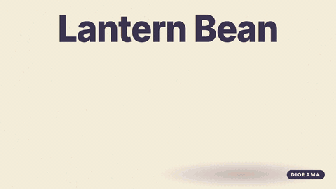

# Diorama



**Good for:** Storytelling, places and product scenes

## The root idea

It must feel like a small model photographed close: a base you can see the edge of, tiny objects and a narrow sharp band.

## How to build it

1. Make a base block with visible layers on its side.
2. Place several small objects of different heights.
3. Give each a soft shadow touching the base.
4. Blur the top and bottom of the picture, never the text.

## How it moves

Objects drop in one by one and settle; the camera pushes in slowly.

## Avoid

- One object alone on a big empty ground
- No contact shadows
- Blur over words

## Colours in this demo

`#3B3552` `#CDB9F0` `#FFF7EC` `#C99A72` `#6FBE9B` `#F27D6A`

## How this demo is made

A single HTML page animated with GSAP and rendered with HyperFrames.

- Shapes and objects are drawn with SVG.
- Clipping cuts or reveals shapes.
- Backdrop blur softens what is behind a panel.
- Gradients are used for colour or light.
- Random placement uses a fixed seed, so each render is the same.

## Prompt to reuse

```text
Make a [LENGTH]-second HyperFrames video about [TOPIC].
Style: miniature model diorama, layered square base, tiny props, soft shadows, tilt-shift blur, pastel colours.
Movement: Objects drop in one by one and settle; the camera pushes in slowly.
Make your own design. Keep the main text large and readable, and show only a little text at a time.
Before the final render, look at still frames and fix anything cut off, broken or hard to read.
```

## Render the demo again

```bash
cd source
npx hyperframes@latest render --output demo.mp4
```

Needs Node.js, FFmpeg and an internet connection (GSAP loads from a CDN). Fonts are in `source/assets/` with their licence files.

The shop "Lantern Bean" is made up.
