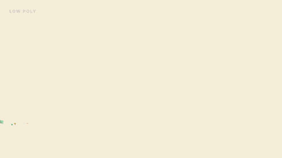

# Low Poly



**Good for:** Games, nature and tech visuals

## The root idea

Round things are made from a few flat triangles, and each face gets one light level.

## How to build it

1. Build shapes from large polygons.
2. Choose one light direction.
3. Shade each face with light, middle or dark.
4. Use seeded random numbers so every render is the same.

## How it moves

Faces build in solid groups, bottom to top.

## Avoid

- Showing half-built objects that look broken
- Smooth gradients across a face
- Too many tiny triangles

## Colours in this demo

`#3B3552` `#2F5FD8` `#F6EEDD` `#FBF4E6` `#4DAF72` `#9ED7A8`

## How this demo is made

A single HTML page animated with GSAP and rendered with HyperFrames.

- Shapes and objects are drawn with SVG.
- Random placement uses a fixed seed, so each render is the same.

## Prompt to reuse

```text
Make a [LENGTH]-second HyperFrames video about [TOPIC].
Style: low-poly 3D look, large flat triangular faces with three-step shading, soft bright colours.
Movement: Faces build in solid groups, bottom to top.
Make your own design. Keep the main text large and readable, and show only a little text at a time.
Before the final render, look at still frames and fix anything cut off, broken or hard to read.
```

## Render the demo again

```bash
cd source
npx hyperframes@latest render --output demo.mp4
```

Needs Node.js, FFmpeg and an internet connection (GSAP loads from a CDN). Fonts are in `source/assets/` with their licence files.

The shop "Lantern Bean" is made up.
