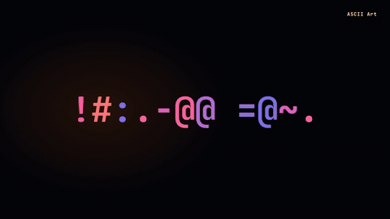

# ASCII Art



**Good for:** Developer and tech content

## The root idea

A picture is a grid of text characters, where denser characters read as brighter.

## How to build it

1. Use a monospace font on a fixed cell grid.
2. Order characters from light to dense.
3. Turn the shape and its shading into that order.
4. Keep dim colours bright enough to see, and show key words as normal large text.

## How it moves

Cells flicker through random characters and settle into the picture.

## Avoid

- Very dim characters on black
- Tiny cells that disappear in video compression
- Moving the grid itself

## Colours in this demo

`#FFF6DA` `#FFC530` `#06060A` `#FF6A1A`

## How this demo is made

A single HTML page animated with GSAP and rendered with HyperFrames.

- Gradients are used for colour or light.

## Prompt to reuse

```text
Make a [LENGTH]-second HyperFrames video about [TOPIC].
Style: ASCII art on a near-black screen, monospace character grid, warm glowing colours.
Movement: Cells flicker through random characters and settle into the picture.
Make your own design. Keep the main text large and readable, and show only a little text at a time.
Before the final render, look at still frames and fix anything cut off, broken or hard to read.
```

## Render the demo again

```bash
cd source
npx hyperframes@latest render --output demo.mp4
```

Needs Node.js, FFmpeg and an internet connection (GSAP loads from a CDN). Fonts are in `source/assets/` with their licence files.

The shop "Lantern Bean" is made up.
