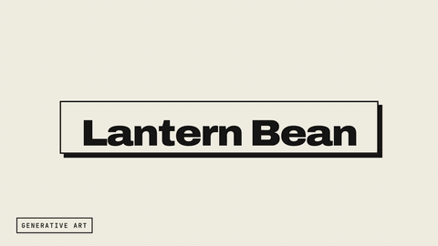

# Generative Art



**Good for:** Creative openings and brand backgrounds

## The root idea

You design rules, not single strokes: lines follow an invisible flow field and the code places them.

## How to build it

1. Make a flow field from a seeded formula.
2. Grow strokes along it.
3. Keep a minimum gap so strokes do not collide.
4. Place large strokes first, then fill gaps with small ones.
5. Keep text on its own solid card.

## How it moves

Strokes draw themselves, large first.

## Avoid

- Unseeded randomness (each render changes)
- Text directly on the strokes

## Colours in this demo

`#161616` `#FF2D8A` `#F3EEE2` `#FF6A1A` `#2346E0` `#FFC530`

## How this demo is made

A single HTML page animated with GSAP and rendered with HyperFrames.

- Shapes and objects are drawn with SVG.
- Clipping cuts or reveals shapes.
- Lines are revealed by animating the stroke dash.
- Random placement uses a fixed seed, so each render is the same.

## Prompt to reuse

```text
Make a [LENGTH]-second HyperFrames video about [TOPIC].
Style: generative flow-field ribbons placed by rules, bold colour on cream, solid text cards with hard shadows.
Movement: Strokes draw themselves, large first.
Make your own design. Keep the main text large and readable, and show only a little text at a time.
Before the final render, look at still frames and fix anything cut off, broken or hard to read.
```

## Render the demo again

```bash
cd source
npx hyperframes@latest render --output demo.mp4
```

Needs Node.js, FFmpeg and an internet connection (GSAP loads from a CDN). Fonts are in `source/assets/` with their licence files.

The shop "Lantern Bean" is made up.
