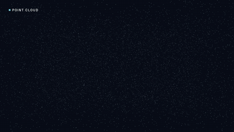

# Point Cloud



**Good for:** AI, data and science content

## The root idea

Shapes are made of thousands of dots, like a 3D scan.

## How to build it

1. Sample points from the text and the object shape.
2. Draw on canvas with a seeded random generator.
3. Use enough points and brightness that the shape reads at once.
4. Keep small text as normal type.

## How it moves

Scattered points gather into the shape, then drift slightly.

## Avoid

- Too few points
- A name that stays unformed too long

## Colours in this demo

`#090E18` `#F5F5F2` `#56CDDD`

## How this demo is made

A single HTML page animated with GSAP and rendered with HyperFrames.

- The picture is drawn on a canvas, frame by frame.
- Random placement uses a fixed seed, so each render is the same.

## Prompt to reuse

```text
Make a [LENGTH]-second HyperFrames video about [TOPIC].
Style: glowing point cloud on dark navy, cyan and white dots forming shapes, clean sans-serif captions.
Movement: Scattered points gather into the shape, then drift slightly.
Make your own design. Keep the main text large and readable, and show only a little text at a time.
Before the final render, look at still frames and fix anything cut off, broken or hard to read.
```

## Render the demo again

```bash
cd source
npx hyperframes@latest render --output demo.mp4
```

Needs Node.js, FFmpeg and an internet connection (GSAP loads from a CDN). Fonts are in `source/assets/` with their licence files.

The shop "Lantern Bean" is made up.
