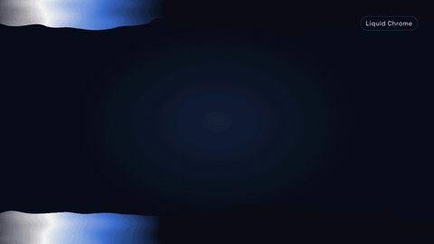

# Liquid Chrome



**Good for:** Music, fashion and tech openers

## The root idea

Mirror metal is shown by sharp changes between light and dark bands that bend.

## How to build it

1. Make gradients with strong light and dark steps.
2. Bend them with a noise displacement filter.
3. Keep the metal away from the reading area.

## How it moves

Reflections slide and edges ripple.

## Avoid

- Smooth grey gradients (they look like plastic)
- Chrome behind text

## Colours in this demo

`#F5F5F2` `#3C6FD1` `#ED80B8` `#090E18` `#14203A` `#0A1020`

## How this demo is made

A single HTML page animated with GSAP and rendered with HyperFrames.

- Shapes and objects are drawn with SVG.
- An SVG noise filter adds texture.
- A displacement filter bends edges so they are less perfect.
- Gradients are used for colour or light.
- Random placement uses a fixed seed, so each render is the same.

## Prompt to reuse

```text
Make a [LENGTH]-second HyperFrames video about [TOPIC].
Style: liquid chrome ribbons with sharp pink, blue and white reflections on dark navy, clean light type.
Movement: Reflections slide and edges ripple.
Make your own design. Keep the main text large and readable, and show only a little text at a time.
Before the final render, look at still frames and fix anything cut off, broken or hard to read.
```

## Render the demo again

```bash
cd source
npx hyperframes@latest render --output demo.mp4
```

Needs Node.js, FFmpeg and an internet connection (GSAP loads from a CDN). Fonts are in `source/assets/` with their licence files.

The shop "Lantern Bean" is made up.
