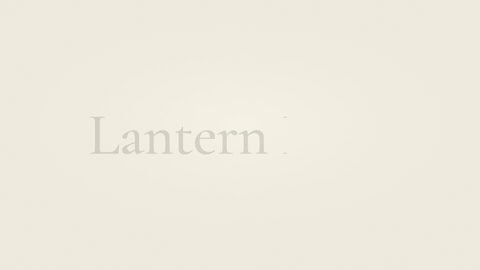

# Ink Wash



**Good for:** Calm, culture, tea and wellness content

## The root idea

Water carries the ink: soft bleeding edges, uneven tone, dry brush marks and much empty paper.

## How to build it

1. Start with warm paper and grain.
2. Layer shapes with low opacity for uneven tone.
3. Bend edges with a noise filter and add a soft bleed.
4. Add one small red accent.
5. Leave large empty space.

## How it moves

Ink spreads and strokes are revealed along their path.

## Avoid

- Flat solid vector shapes
- Many colours
- Filling the whole page

## Colours in this demo

`#F2EDE1` `#141413` `#3A3935` `#C8372D` `#2E2D29` `#1C1B19`

## How this demo is made

A single HTML page animated with GSAP and rendered with HyperFrames.

- Shapes and objects are drawn with SVG.
- An SVG noise filter adds texture.
- A displacement filter bends edges so they are less perfect.
- Clipping cuts or reveals shapes.
- Lines are revealed by animating the stroke dash.
- Gradients are used for colour or light.
- Random placement uses a fixed seed, so each render is the same.

## Prompt to reuse

```text
Make a [LENGTH]-second HyperFrames video about [TOPIC].
Style: East Asian ink wash on warm paper, bleeding edges, dry brush strokes, one red accent, serif type.
Movement: Ink spreads and strokes are revealed along their path.
Make your own design. Keep the main text large and readable, and show only a little text at a time.
Before the final render, look at still frames and fix anything cut off, broken or hard to read.
```

## Render the demo again

```bash
cd source
npx hyperframes@latest render --output demo.mp4
```

Needs Node.js, FFmpeg and an internet connection (GSAP loads from a CDN). Fonts are in `source/assets/` with their licence files.

The shop "Lantern Bean" is made up.
