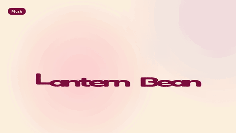

# Plush



**Good for:** Kids, toys and playful brands

## The root idea

Softness comes from many short fibres at the edge, and from a body that squashes while the fur follows late.

## How to build it

1. Make a rounded shape.
2. Add many short seeded strands in two or three shades.
3. Add soft highlights and a soft shadow.

## How it moves

Squash and spring; the fur lags behind and settles.

## Avoid

- Hard edges
- Fibres only on one side

## Colours in this demo

`#7D0A3C` `#7B52FF` `#FFF1E0` `#FF6FA8` `#FF4F97` `#B8245F`

## How this demo is made

A single HTML page animated with GSAP and rendered with HyperFrames.

- Shapes and objects are drawn with SVG.
- An SVG noise filter adds texture.
- A displacement filter bends edges so they are less perfect.
- Lines are revealed by animating the stroke dash.
- Gradients are used for colour or light.
- Random placement uses a fixed seed, so each render is the same.

## Prompt to reuse

```text
Make a [LENGTH]-second HyperFrames video about [TOPIC].
Style: soft plush toy material, dense short fibres, pink and violet on cream, rounded bold type.
Movement: Squash and spring; the fur lags behind and settles.
Make your own design. Keep the main text large and readable, and show only a little text at a time.
Before the final render, look at still frames and fix anything cut off, broken or hard to read.
```

## Render the demo again

```bash
cd source
npx hyperframes@latest render --output demo.mp4
```

Needs Node.js, FFmpeg and an internet connection (GSAP loads from a CDN). Fonts are in `source/assets/` with their licence files.

The shop "Lantern Bean" is made up.
