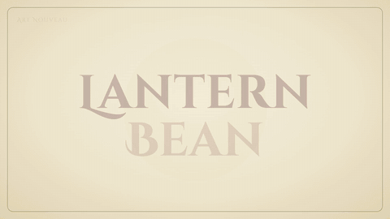

# Art Nouveau



**Good for:** Beauty, flowers, craft and heritage content

## The root idea

Long curving lines that start thick and end thin, like growing plants.

## How to build it

1. Draw tapered curves as filled shapes.
2. Frame the content with them.
3. Use muted olive, gold, plum and cream.
4. Pair a decorative display face with a gentle italic.

## How it moves

Vines grow along their curves.

## Avoid

- Straight hard geometry
- Curves crossing the words

## Colours in this demo

`#4E5A34` `#C49A4A` `#7F8F5E` `#EFE6CF` `#E6CF97` `#6B3A4A`

## How this demo is made

A single HTML page animated with GSAP and rendered with HyperFrames.

- Shapes and objects are drawn with SVG.
- Lines are revealed by animating the stroke dash.
- Gradients are used for colour or light.

## Prompt to reuse

```text
Make a [LENGTH]-second HyperFrames video about [TOPIC].
Style: Art Nouveau tapered whiplash curves, gold halo, muted olive and plum on cream, decorative serif.
Movement: Vines grow along their curves.
Make your own design. Keep the main text large and readable, and show only a little text at a time.
Before the final render, look at still frames and fix anything cut off, broken or hard to read.
```

## Render the demo again

```bash
cd source
npx hyperframes@latest render --output demo.mp4
```

Needs Node.js, FFmpeg and an internet connection (GSAP loads from a CDN). Fonts are in `source/assets/` with their licence files.

The shop "Lantern Bean" is made up.
