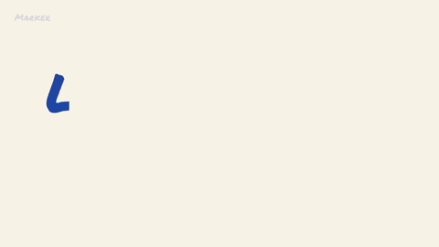

# Marker



**Good for:** Teaching, explainers and friendly promos

## The root idea

It looks drawn by hand: wobbly outlines, streaky fills and darker overlaps.

## How to build it

1. Draw outlines as paths and wobble them with a noise filter.
2. Fill with streaked colour.
3. Use multiply blending so overlaps darken.
4. Use a marker-style font.

## How it moves

Lines are drawn stroke by stroke, in a natural order.

## Avoid

- Perfect straight lines
- Fills that appear before their outline

## Colours in this demo

`#E4562C` `#FAF3E7` `#F2B01E` `#2148A8`

## How this demo is made

A single HTML page animated with GSAP and rendered with HyperFrames.

- Shapes and objects are drawn with SVG.
- An SVG noise filter adds texture.
- A displacement filter bends edges so they are less perfect.
- Blend modes mix overlapping colours.
- Clipping cuts or reveals shapes.
- Lines are revealed by animating the stroke dash.
- Random placement uses a fixed seed, so each render is the same.

## Prompt to reuse

```text
Make a [LENGTH]-second HyperFrames video about [TOPIC].
Style: hand-drawn marker illustration on cream paper, blue outlines, streaky orange fills, marker lettering.
Movement: Lines are drawn stroke by stroke, in a natural order.
Make your own design. Keep the main text large and readable, and show only a little text at a time.
Before the final render, look at still frames and fix anything cut off, broken or hard to read.
```

## Render the demo again

```bash
cd source
npx hyperframes@latest render --output demo.mp4
```

Needs Node.js, FFmpeg and an internet connection (GSAP loads from a CDN). Fonts are in `source/assets/` with their licence files.

The shop "Lantern Bean" is made up.
