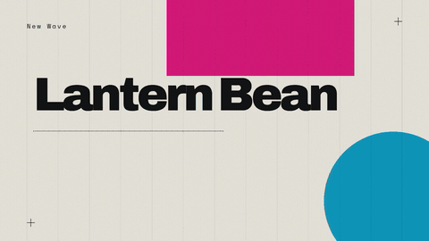

# New Wave



**Good for:** Music, art and design events

## The root idea

A clean grid that is deliberately broken: shifted words, overlapping colour sheets and small technical marks.

## How to build it

1. Draw faint column guides.
2. Step words up and down.
3. Overlap flat magenta, cyan and yellow shapes.
4. Add halftone patches and crosshair marks.
5. Keep shapes away from the letters.

## How it moves

Letters drop in one by one; colour sheets slide.

## Avoid

- Dark overlaps behind dark text

## Colours in this demo

`#141414` `#EC1C8C` `#12A8D8` `#E6E2DA` `#FFD21F`

## How this demo is made

A single HTML page animated with GSAP and rendered with HyperFrames.

- Shapes and objects are drawn with SVG.
- An SVG noise filter adds texture.
- Blend modes mix overlapping colours.
- Clipping cuts or reveals shapes.
- Lines are revealed by animating the stroke dash.
- Gradients are used for colour or light.

## Prompt to reuse

```text
Make a [LENGTH]-second HyperFrames video about [TOPIC].
Style: New Wave typography, broken grid, stepped words, magenta, cyan and yellow sheets, halftone and crosshair marks.
Movement: Letters drop in one by one; colour sheets slide.
Make your own design. Keep the main text large and readable, and show only a little text at a time.
Before the final render, look at still frames and fix anything cut off, broken or hard to read.
```

## Render the demo again

```bash
cd source
npx hyperframes@latest render --output demo.mp4
```

Needs Node.js, FFmpeg and an internet connection (GSAP loads from a CDN). Fonts are in `source/assets/` with their licence files.

The shop "Lantern Bean" is made up.
