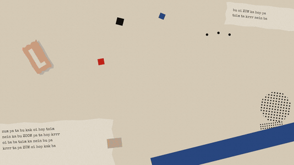

# Dada



**Good for:** Storytelling, art and unusual openers

## The root idea

A collage of cut scraps that looks accidental but still has one clear reading order.

## How to build it

1. Give each letter or word its own scrap, font and tilt.
2. Add torn strips, dots and paper grain.
3. Use nonsense filler text, never real printed material.
4. Keep one strong focal object.

## How it moves

Scraps jump into place and wobble.

## Avoid

- Real people, brands or publications
- Chaos that hides the message

## Colours in this demo

`#16130F` `#D3261C` `#F4EEE0` `#D9A72B` `#E7DDC8` `#CBB58E`

## How this demo is made

A single HTML page animated with GSAP and rendered with HyperFrames.

- Shapes and objects are drawn with SVG.
- An SVG noise filter adds texture.
- Blend modes mix overlapping colours.
- Clipping cuts or reveals shapes.
- Lines are revealed by animating the stroke dash.
- Gradients are used for colour or light.
- Random placement uses a fixed seed, so each render is the same.

## Prompt to reuse

```text
Make a [LENGTH]-second HyperFrames video about [TOPIC].
Style: Dada paper collage, mixed cut-out lettering, torn strips, halftone, red, ochre and blue on kraft paper.
Movement: Scraps jump into place and wobble.
Make your own design. Keep the main text large and readable, and show only a little text at a time.
Before the final render, look at still frames and fix anything cut off, broken or hard to read.
```

## Render the demo again

```bash
cd source
npx hyperframes@latest render --output demo.mp4
```

Needs Node.js, FFmpeg and an internet connection (GSAP loads from a CDN). Fonts are in `source/assets/` with their licence files.

The shop "Lantern Bean" is made up.
