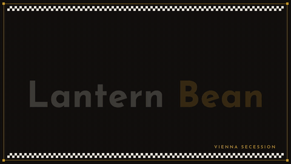

# Vienna Secession



**Good for:** Gallery, premium and heritage content

## The root idea

Elegant order made from squares: checker bands, small gold squares and calm framed panels.

## How to build it

1. Use near-black, ivory and gold.
2. Add checkerboard bands and thin gold frames.
3. Place the object in a square panel, centred.
4. Use a tall geometric typeface.

## How it moves

Slow reveals; small ornaments pulse.

## Avoid

- Random ornament
- Off-centre objects inside the panel

## Colours in this demo

`#C99A2E` `#F2EDE2` `#121110` `#6E2A17` `#D9D2C2`

## How this demo is made

A single HTML page animated with GSAP and rendered with HyperFrames.

- Shapes and objects are drawn with SVG.
- Lines are revealed by animating the stroke dash.

## Prompt to reuse

```text
Make a [LENGTH]-second HyperFrames video about [TOPIC].
Style: Vienna Secession geometry, gold squares and checker bands on near-black, square framed panel, geometric type.
Movement: Slow reveals; small ornaments pulse.
Make your own design. Keep the main text large and readable, and show only a little text at a time.
Before the final render, look at still frames and fix anything cut off, broken or hard to read.
```

## Render the demo again

```bash
cd source
npx hyperframes@latest render --output demo.mp4
```

Needs Node.js, FFmpeg and an internet connection (GSAP loads from a CDN). Fonts are in `source/assets/` with their licence files.

The shop "Lantern Bean" is made up.
