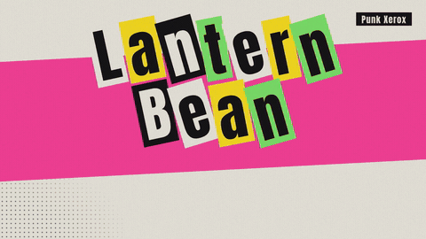

# Punk Xerox



**Good for:** Music, events and street brands

## The root idea

A photocopied fan magazine: high contrast, cut letters, tape, grain and one fluorescent colour.

## How to build it

1. Use black ink, paper and bright pink and yellow.
2. Cut each name letter into its own tile.
3. Add tape strips, dot screens and copy grain.
4. Keep the message on a flat strip.

## How it moves

Pieces slam in; dot screens turn.

## Avoid

- Strong flashing
- Grain so heavy that text breaks

## Colours in this demo

`#121012` `#F1EEE4` `#FF3E9A` `#FFE21A` `#7BE86A`

## How this demo is made

A single HTML page animated with GSAP and rendered with HyperFrames.

- Shapes and objects are drawn with SVG.
- An SVG noise filter adds texture.
- Clipping cuts or reveals shapes.
- Lines are revealed by animating the stroke dash.
- Gradients are used for colour or light.

## Prompt to reuse

```text
Make a [LENGTH]-second HyperFrames video about [TOPIC].
Style: photocopy punk zine, cut-out letter tiles, tape, halftone and grain, black with hot pink and yellow.
Movement: Pieces slam in; dot screens turn.
Make your own design. Keep the main text large and readable, and show only a little text at a time.
Before the final render, look at still frames and fix anything cut off, broken or hard to read.
```

## Render the demo again

```bash
cd source
npx hyperframes@latest render --output demo.mp4
```

Needs Node.js, FFmpeg and an internet connection (GSAP loads from a CDN). Fonts are in `source/assets/` with their licence files.

The shop "Lantern Bean" is made up.
