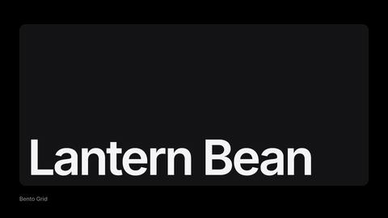

# Bento Grid



**Good for:** Product features and summaries (a layout)

## The root idea

Content is split into boxes of different sizes. Size shows importance.

## How to build it

1. Set columns and one gap size.
2. Give the most important item the biggest box.
3. Use the same corner radius everywhere.
4. Put one idea in each box.

## How it moves

One big box shrinks into place and the others appear around it.

## Avoid

- Equal boxes for unequal content
- Filling boxes with invented claims

## Colours in this demo

`#F5F5F7` `#86868B` `#FF8A1F` `#FF2D6F` `#A63DFF` `#000000`

## How this demo is made

A single HTML page animated with GSAP and rendered with HyperFrames.

- Shapes and objects are drawn with SVG.
- Lines are revealed by animating the stroke dash.
- Gradients are used for colour or light.

## Prompt to reuse

```text
Make a [LENGTH]-second HyperFrames video about [TOPIC].
Style: bento grid layout, rounded cards of different sizes, equal gaps, dark theme, one gradient accent.
Movement: One big box shrinks into place and the others appear around it.
Make your own design. Keep the main text large and readable, and show only a little text at a time.
Before the final render, look at still frames and fix anything cut off, broken or hard to read.
```

## Render the demo again

```bash
cd source
npx hyperframes@latest render --output demo.mp4
```

Needs Node.js, FFmpeg and an internet connection (GSAP loads from a CDN). Fonts are in `source/assets/` with their licence files.

The shop "Lantern Bean" is made up.
