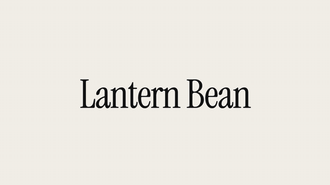

# Masonry



**Good for:** Galleries and collections (a layout)

## The root idea

Equal-width columns, different card heights. Each new card goes to the shortest column.

## How to build it

1. Choose the column width and gap.
2. Give cards different height ratios.
3. Place each card in the shortest column by code.
4. Make the featured card clearly larger.

## How it moves

Cards land one by one.

## Avoid

- A featured card so small that it cannot be read

## Colours in this demo

`#141414` `#6F6A62` `#0D0E10` `#F2462E` `#E9E2D3` `#F2EFE9`

## How this demo is made

A single HTML page animated with GSAP and rendered with HyperFrames.

- Shapes and objects are drawn with SVG.
- Gradients are used for colour or light.

## Prompt to reuse

```text
Make a [LENGTH]-second HyperFrames video about [TOPIC].
Style: masonry layout, equal columns with varied card heights, warm off-white, one vermilion accent.
Movement: Cards land one by one.
Make your own design. Keep the main text large and readable, and show only a little text at a time.
Before the final render, look at still frames and fix anything cut off, broken or hard to read.
```

## Render the demo again

```bash
cd source
npx hyperframes@latest render --output demo.mp4
```

Needs Node.js, FFmpeg and an internet connection (GSAP loads from a CDN). Fonts are in `source/assets/` with their licence files.

The shop "Lantern Bean" is made up.
