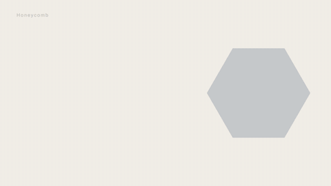

# Honeycomb



**Good for:** Networks, teams and feature maps (a layout)

## The root idea

Six-sided cells tile without gaps. One larger cell is the focus.

## How to build it

1. Calculate cell positions from the hexagon size.
2. Reserve clear space for the text.
3. Put the main object in a large central cell.
4. Colour only a few cells.

## How it moves

Cells grow outward from the centre.

## Avoid

- Text cut by cell edges
- Every cell coloured

## Colours in this demo

`#F2EFE8` `#101016` `#F2AF43` `#0D254B`

## How this demo is made

A single HTML page animated with GSAP and rendered with HyperFrames.

- Shapes and objects are drawn with SVG.

## Prompt to reuse

```text
Make a [LENGTH]-second HyperFrames video about [TOPIC].
Style: honeycomb hexagon layout, navy and amber cells on warm paper, one large focus cell, bold sans-serif.
Movement: Cells grow outward from the centre.
Make your own design. Keep the main text large and readable, and show only a little text at a time.
Before the final render, look at still frames and fix anything cut off, broken or hard to read.
```

## Render the demo again

```bash
cd source
npx hyperframes@latest render --output demo.mp4
```

Needs Node.js, FFmpeg and an internet connection (GSAP loads from a CDN). Fonts are in `source/assets/` with their licence files.

The shop "Lantern Bean" is made up.
