# Design styles

26 motion design styles and 3 layouts. Each folder has a 5-second GIF demo, notes on how to build the style,
a prompt to reuse and the source of the demo. All demos use the same made-up coffee shop, so you can compare them.

## Styles

<table>
<tr>
<td width="33%" align="center"><a href="01-bauhaus/">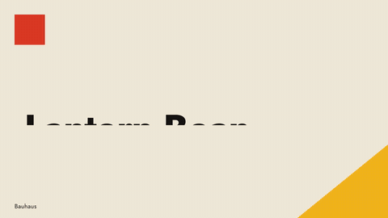</a> <b><a href="01-bauhaus/">Bauhaus</a></b></td>
<td width="33%" align="center"><a href="02-swiss-style/">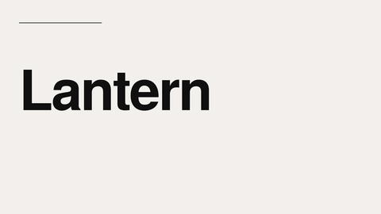</a> <b><a href="02-swiss-style/">Swiss Style</a></b></td>
<td width="33%" align="center"><a href="03-constructivism/">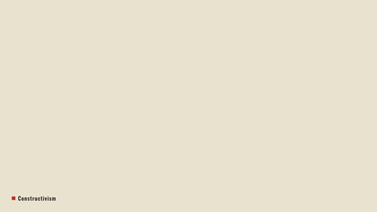</a> <b><a href="03-constructivism/">Constructivism</a></b></td>
</tr>
<tr>
<td width="33%" align="center"><a href="04-memphis/">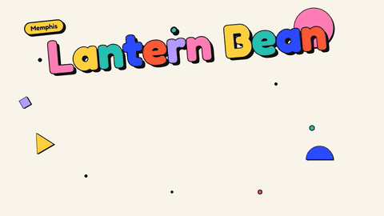</a> <b><a href="04-memphis/">Memphis</a></b></td>
<td width="33%" align="center"><a href="05-pop-art/">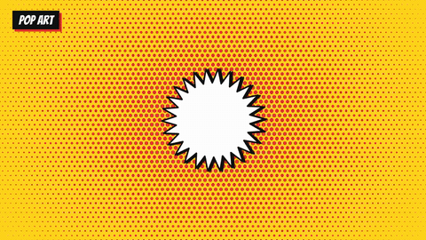</a> <b><a href="05-pop-art/">Pop Art</a></b></td>
<td width="33%" align="center"><a href="06-y2k/">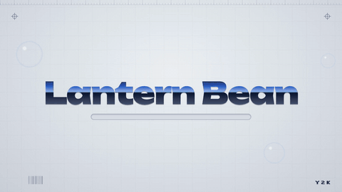</a> <b><a href="06-y2k/">Y2K</a></b></td>
</tr>
<tr>
<td width="33%" align="center"><a href="07-risograph/">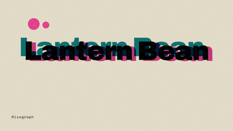</a> <b><a href="07-risograph/">Risograph</a></b></td>
<td width="33%" align="center"><a href="08-neo-brutalism/">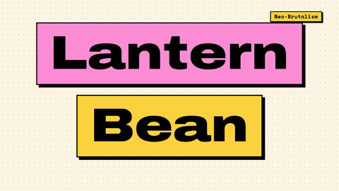</a> <b><a href="08-neo-brutalism/">Neo-Brutalism</a></b></td>
<td width="33%" align="center"><a href="09-art-deco/">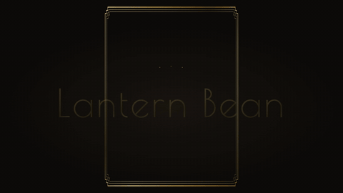</a> <b><a href="09-art-deco/">Art Deco</a></b></td>
</tr>
<tr>
<td width="33%" align="center"><a href="10-liquid-glass/">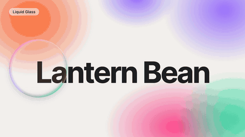</a> <b><a href="10-liquid-glass/">Liquid Glass</a></b></td>
<td width="33%" align="center"><a href="11-futurism/">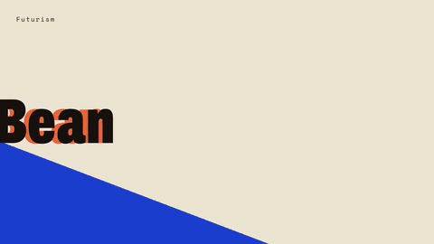</a> <b><a href="11-futurism/">Futurism</a></b></td>
<td width="33%" align="center"><a href="12-mid-century-modern/">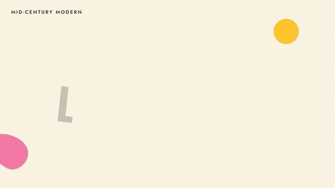</a> <b><a href="12-mid-century-modern/">Mid-Century Modern</a></b></td>
</tr>
<tr>
<td width="33%" align="center"><a href="13-diorama/">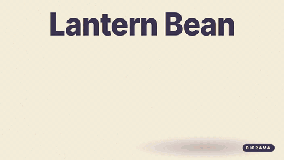</a> <b><a href="13-diorama/">Diorama</a></b></td>
<td width="33%" align="center"><a href="14-low-poly/">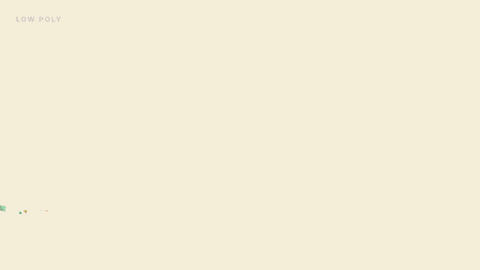</a> <b><a href="14-low-poly/">Low Poly</a></b></td>
<td width="33%" align="center"><a href="15-ascii-art/">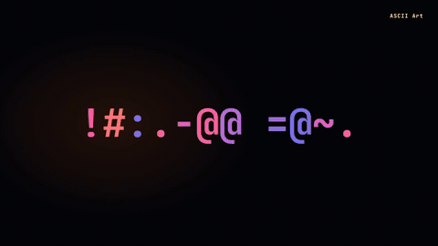</a> <b><a href="15-ascii-art/">ASCII Art</a></b></td>
</tr>
<tr>
<td width="33%" align="center"><a href="16-generative-art/">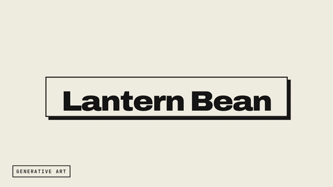</a> <b><a href="16-generative-art/">Generative Art</a></b></td>
<td width="33%" align="center"> <b><a href="17-point-cloud/">Point Cloud</a></b></td>
<td width="33%" align="center"><a href="18-liquid-chrome/">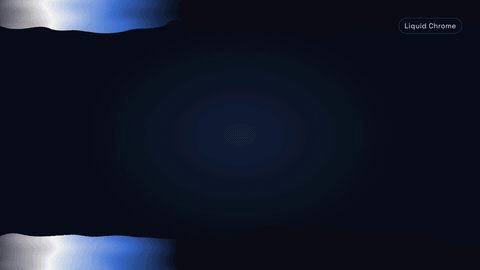</a> <b><a href="18-liquid-chrome/">Liquid Chrome</a></b></td>
</tr>
<tr>
<td width="33%" align="center"> <b><a href="19-ink-wash/">Ink Wash</a></b></td>
<td width="33%" align="center"><a href="20-plush/">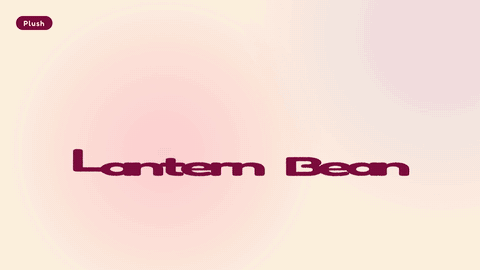</a> <b><a href="20-plush/">Plush</a></b></td>
<td width="33%" align="center"><a href="21-art-nouveau/">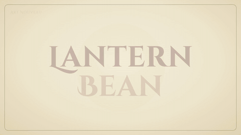</a> <b><a href="21-art-nouveau/">Art Nouveau</a></b></td>
</tr>
<tr>
<td width="33%" align="center"><a href="22-marker/">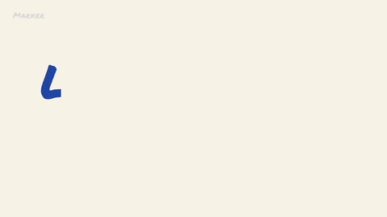</a> <b><a href="22-marker/">Marker</a></b></td>
<td width="33%" align="center"><a href="23-new-wave/">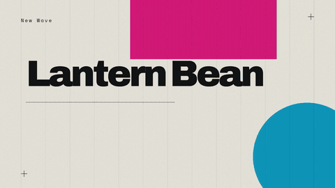</a> <b><a href="23-new-wave/">New Wave</a></b></td>
<td width="33%" align="center"><a href="24-dada/">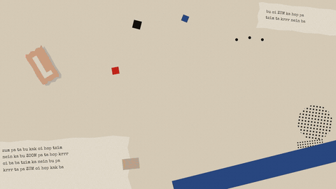</a> <b><a href="24-dada/">Dada</a></b></td>
</tr>
<tr>
<td width="33%" align="center"><a href="25-vienna-secession/">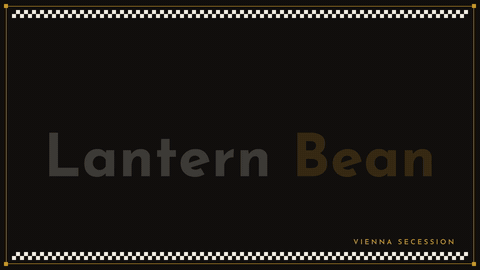</a> <b><a href="25-vienna-secession/">Vienna Secession</a></b></td>
<td width="33%" align="center"><a href="26-punk-xerox/">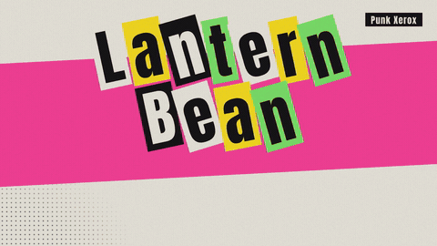</a> <b><a href="26-punk-xerox/">Punk Xerox</a></b></td>
</tr>
</table>

## Layouts

<table>
<tr>
<td width="33%" align="center"><a href="27-bento-grid/">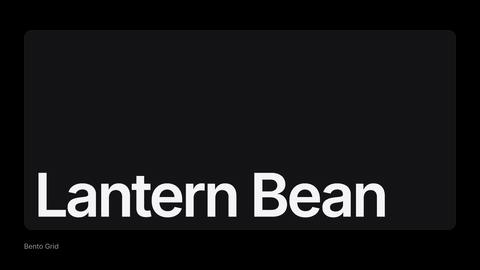</a> <b><a href="27-bento-grid/">Bento Grid</a></b></td>
<td width="33%" align="center"><a href="28-masonry/">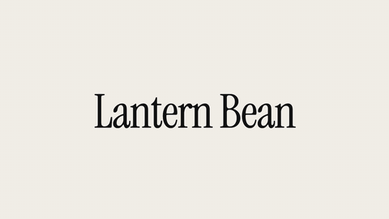</a> <b><a href="28-masonry/">Masonry</a></b></td>
<td width="33%" align="center"><a href="29-honeycomb/">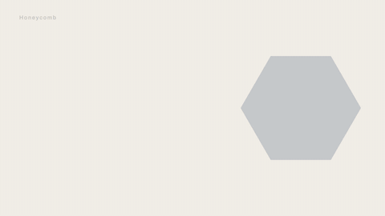</a> <b><a href="29-honeycomb/">Honeycomb</a></b></td>
</tr>
</table>
